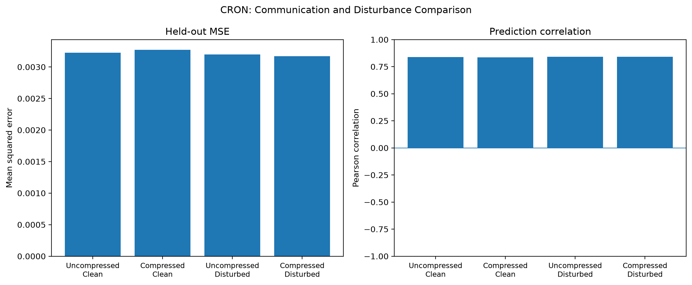
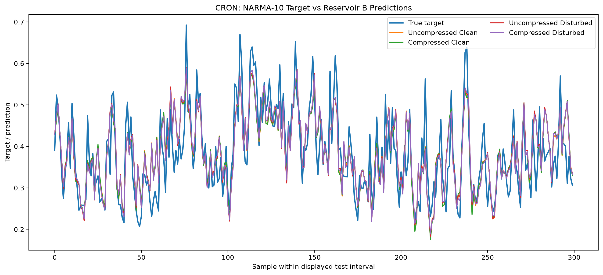

# CRON — Smart Communication Between Reservoir Computers

## Why I'm building this

Reservoir computers process information through the dynamics of a recurrent network. But when two reservoirs need to communicate, simply transmitting the entire state vector at every timestep may be wasteful, especially when the reservoirs eventually need to operate on separate embedded devices.

I wanted to explore whether communication between reservoirs could be made more efficient without losing too much of the information required for the task. This is the starting point for CRON: an attempt at **smart communication between reservoir computers**, with the longer-term goal of supporting communication within or across devices.

The idea is to treat communication as part of the computing system, rather than assume that every reservoir state must always be transmitted in full.

## What I've implemented so far

The current implementation is a software simulation using the NARMA-10 time-series prediction task.

- **Reservoir A** processes the input and produces a sequence of reservoir states.
- **Communication layer** applies a Discrete Wavelet Transform (DWT) to each state vector, retains a limited set of coefficients, and uses the inverse DWT (IDWT) to reconstruct an approximate state.
- **Reservoir B** processes the received states and uses a polynomial readout to predict the original NARMA-10 target.
- **Reservoir D** generates a structured disturbance for testing how the communication path behaves when the information received by B is perturbed.

The reservoirs have independent recurrent weights. The communication layer is deliberately kept separate from the reservoir implementation so that the encoding and decoding mechanism can be changed without redesigning the reservoirs.

## Why DWT?

The initial approach uses DWT to represent a reservoir state in terms of approximation and detail coefficients. Instead of transmitting every coefficient, the communication layer retains a fixed number of coefficients and reconstructs an approximate state at the receiver.

For the current configuration, the state dimension is 100 and the communication budget is 40 coefficients per timestep. This reduces the number of transmitted scalar values by 60%, before accounting for metadata or encoding overhead.

The objective is not to reconstruct the original state perfectly. It is to investigate whether the receiver can still perform the intended task when some information has been discarded.

Applying DWT across the neuron dimension is a modelling choice in this experiment. It does not assume that adjacent neuron indices have a physical relationship.

## The first experiment

Before introducing disturbances, I compared an uncompressed A-to-B connection against the DWT-compressed connection.

Both cases use the same reservoir configurations, target sequence, chronological train/test split, and readout procedure. This provides an initial reference for the performance cost of compression.

The next experiment introduces a structured disturbance generated by a third reservoir. The disturbance is added directly to B's input, with a fixed coupling strength of 1. Its mean is estimated over the training interval and removed to isolate its time-varying component.

The comparison covers four conditions:

1. Uncompressed communication without disturbance.
2. Compressed communication without disturbance.
3. Uncompressed communication with disturbance.
4. Compressed communication with disturbance.

## Results

The first unperturbed comparison gave the following results on the held-out test set:

| Metric | Uncompressed | DWT-compressed |
|---|---:|---:|
| Test MSE | 0.003224 | 0.003270 |
| Prediction correlation | 0.83878 | 0.83635 |
| Scalar values per timestep | 100 | 40 |

The compressed case had approximately 1.43% higher MSE, while using 60% fewer scalar values per timestep. This is an encouraging initial result, but it comes from one configuration and one run; it is not evidence of general performance across reservoirs or tasks.

The plots and complete results from all four experimental conditions are generated by `experiment.py`.

### Metric comparison



### Prediction traces




## Current scope and limitations

This is a preliminary software experiment, not a finished communication protocol or hardware implementation.

At this stage, the system uses fixed-budget compression and immediate encode/decode operations. It does not yet measure actual transmission latency, energy consumption, or byte-level overhead. The disturbance is a controlled signal generated by a reservoir, rather than a calibrated model of a particular physical noise source.

The immediate goal is to establish the baseline and measure the effect of compression and disturbance on task performance. Event-driven transmission, adaptive compression, and deployment across separate devices are potential extensions, not claims about the current implementation.

## Running it

Install the required Python dependencies, place `narma10.txt` alongside the source files, and run:

```bash
python experiment.py
```

The experiment prints the results for each condition and saves the comparison plots for inspection.
